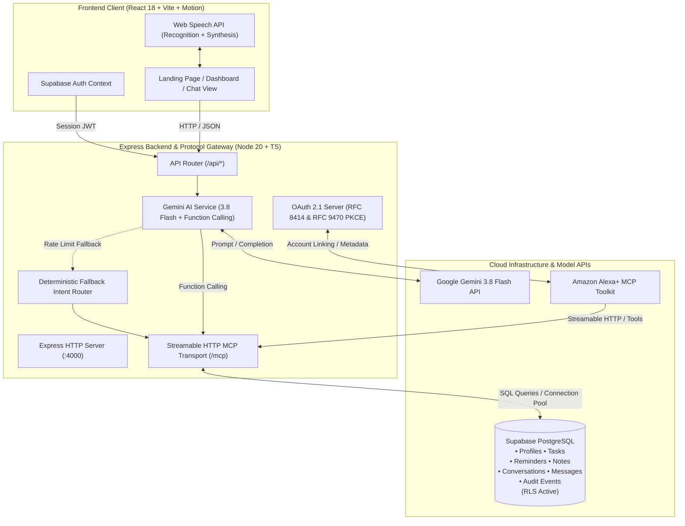

# Alexa+ Smart Assistant (Supabase Edition)

> **Full-Stack AI Product • Premium UI/UX • Supabase PostgreSQL • Google Gemini • Official Model Context Protocol (MCP)**

[](https://www.typescriptlang.org/)
[](https://react.dev/)
[](https://tailwindcss.com/)
[](https://supabase.com/)
[](https://ai.google.dev/)
[](https://modelcontextprotocol.io/)
[]()

---

> [!IMPORTANT]
> **Independent Developer Prototype Notice:**  
> This application is an independent developer demonstration utilizing open-source protocols, Google Gemini AI, and Supabase PostgreSQL. It is **not** an official Amazon product and is not affiliated with, sponsored by, or endorsed by Amazon.com, Inc. "Alexa" is a registered trademark of Amazon.com, Inc.

---

## 🌟 Executive Overview

**Alexa+ Smart Assistant** is a production-minded web application delivering genuine conversational AI integrated with real database persistence and authentic backend tool execution.

Unlike generic AI wrappers that simulate responses, Alexa+ operates on real infrastructure:
* **Real Relational Database:** All profiles, tasks, reminders, notes, chat conversations, and audit events are stored in **Supabase PostgreSQL** protected by strict **Row Level Security (RLS)**.
* **Authentic MCP Server:** Implements the official TypeScript **Model Context Protocol (MCP) SDK** over **Streamable HTTP** at `/mcp`, conforming to JSON-RPC 2.0 specifications.
* **Google Gemini AI Function Calling:** Powered by `gemini-3.8-flash` with deterministic tool invocation, schema argument validation, and an intelligent fallback router.
* **Amazon Alexa+ Readiness:** Features RFC 8414 Authorization Server metadata (`/.well-known/oauth-authorization-server`) and RFC 9470 Protected Resource metadata (`/.well-known/oauth-protected-resource`) for OAuth 2.1 code grant with S256 PKCE account linking.
* **Premium Voice & Microinteraction UI:** Crafted in Midnight Obsidian and Electric Cyan, featuring interactive animated waveforms, speech recognition, neural speech synthesis, and Framer Motion microinteractions.

---

## 🏛️ System Architecture



---

## ✨ Key Product Features

### 1. Interactive Voice Orb & Speech Engine
* **Animated Waveform:** Responsive 5-bar soundwave equalizer reflecting `idle`, `listening`, `processing`, and `speaking` states.
* **Browser Speech Recognition:** Automatic speech-to-text with interim speech streaming and fallback to text input.
* **Neural Text-to-Speech:** High-definition speech synthesis with configurable speed rate (`0.75x` to `1.5x`) and mute controls.

### 2. Conversational Assistant & Chat History
* **Persistent Sessions:** Multi-turn chat sessions saved to Supabase `conversations` and `messages` tables.
* **Conversation History Drawer:** Create new conversations, switch active threads, and inline rename/delete chat history.
* **Tool Execution Accordions:** View real-time tool names, arguments JSON payloads, execution status, and database responses.
* **Follow-up Chips:** Contextual prompt recommendations based on recent actions.
* **One-Click Copy:** Instant clipboard copy for assistant responses.

### 3. Productivity Dashboards
* **Tasks Manager (`/app/tasks`):** Create, filter (by status and priority), complete, and delete tasks with due dates.
* **Reminders Manager (`/app/reminders`):** Schedule time-based reminders with formatted dates and one-click dismissal.
* **Note Library (`/app/notes`):** Full-text keyword search and dynamic tag filtering over markdown notes.
* **Activity & Audit Trail (`/app/activity`):** Real-time security logs of all MCP tool invocations with status badges.
* **MCP & System Inspector (`/app/mcp`):** Developer playground to test any of the 8 MCP tools directly with custom JSON arguments.
* **Settings & Preferences (`/app/settings`):** Manage profile display name, test vocal output, and inspect protocol connection health.

---

## 🛠️ MCP Tool Registry

The MCP server registers 8 deterministic tools:

| Tool Name | Parameters | Description |
| :--- | :--- | :--- |
| `create_task` | `title`*, `description`, `priority`, `due_date` | Creates a task in Supabase PostgreSQL |
| `list_tasks` | `status`, `priority`, `limit` | Queries authenticated user's tasks with filters |
| `update_task` | `task_id`*, `title`, `description`, `priority`, `status` | Modifies an existing task record |
| `create_reminder` | `message`*, `scheduled_time`* | Schedules time-based notification |
| `list_reminders` | `status`, `limit` | Lists user's scheduled or active reminders |
| `save_note` | `title`*, `content`*, `tags` | Stores markdown note with category tags |
| `search_notes` | `query`, `tag`, `limit` | Full-text search across note titles and content |
| `get_assistant_status`| *(None)* | Returns server health, latency, and counts |

*\* Denotes required parameter.*

---

## 🚀 Quickstart Guide

### 1. Prerequisites
* **Node.js** v20.0.0 or higher
* **NPM** v10.0.0 or higher
* **Supabase Project** with direct PostgreSQL URI

### 2. Environment Setup
Copy `.env.example` to `.env` in the project root:
```bash
cp .env.example .env
```
Ensure `.env` contains your Supabase credentials and Gemini API key:
```ini
PORT=4000
NODE_ENV=development
FRONTEND_URL=http://localhost:5173

GEMINI_API_KEY=your_gemini_api_key
GEMINI_MODEL=gemini-3.8-flash

SUPABASE_URL=https://<your-project-id>.supabase.co
SUPABASE_PUBLISHABLE_KEY=sb_publishable_...
DATABASE_URL=postgresql://postgres:<password>@db.<your-project-id>.supabase.co:5432/postgres
```

### 3. Database Migration
Apply the PostgreSQL database migrations to your Supabase instance:
```bash
npm run db:migrate
```
*Applies `20261021000001_create_schema.sql`, `20261021000002_seed_dev_data.sql`, and `20261021000003_add_conversations_and_messages.sql`.*

### 4. Running the Application

To run the backend:
```bash
npm run dev:backend
```
*Backend starts on `http://localhost:4000`.*

To run the frontend:
```bash
npm run dev:frontend
```
*Frontend opens on `http://localhost:5173`.*

---

## 🧪 Automated Testing Suite

The application includes an end-to-end automated test suite:
```bash
npm test
```

### Verified Test Results (50 Passed across 8 Suites):
```
 ✓ tests/health.test.ts (2 tests)
 ✓ tests/auth.test.ts (3 tests)
 ✓ tests/oauth_metadata.test.ts (3 tests)
 ✓ tests/conversations.test.ts (6 tests)
 ✓ tests/db_services.test.ts (4 tests)
 ✓ tests/mcp.test.ts (5 tests)
 ✓ tests/gemini.test.ts (3 tests)
 ✓ tests/all_endpoints.test.ts (24 tests)

 Test Files  8 passed (8)
      Tests  50 passed (50)
```

---

## 📂 Project Structure

```
├── backend/
│   ├── src/
│   │   ├── db/                 # Supabase client, pg connection pool & migration runner
│   │   ├── mcp/                # Official TypeScript MCP server & tool implementations
│   │   ├── middleware/         # Supabase JWT authentication & error handling
│   │   ├── oauth/              # RFC 8414 & RFC 9470 OAuth 2.1 endpoints
│   │   ├── routes/             # REST controllers (assistant, tasks, reminders, notes, conversations)
│   │   ├── services/           # Gemini AI integration, database services & fallback router
│   │   ├── config.ts           # Zod-validated environment configuration
│   │   └── server.ts           # Express server entry point
│   ├── tests/                  # Automated Vitest integration test suites
│   └── package.json
│
├── frontend/
│   ├── src/
│   │   ├── components/         # React UI views (Landing, Chat, Tasks, Reminders, Notes, MCP, Settings)
│   │   ├── context/            # Supabase AuthContext & profile state
│   │   ├── hooks/              # Web Speech API recognition & synthesis hooks
│   │   ├── services/           # Type-safe API client & Supabase client
│   │   ├── App.tsx             # React Router routing & navigation shell
│   │   └── main.tsx
│   ├── package.json
│   └── vite.config.ts
│
├── design/
│   ├── DESIGN_SYSTEM.md        # Color tokens, typography scale, elevation & motion
│   ├── FIGMA_DESIGN_SPEC.md    # Screen-by-screen specifications & auto-layout definitions
│   └── COMPONENT_INVENTORY.md  # Catalog of atomic and composite UI components
│
├── docs/
│   ├── ALEXA_PLUS_ONBOARDING_CHECKLIST.md  # Amazon Developer Console MCP Toolkit guide
│   ├── API_DOCUMENTATION.md                # Comprehensive REST API specifications
│   ├── MCP_TESTING_GUIDE.md                # CLI & Inspector testing procedures
│   ├── DEPLOYMENT_GUIDE.md                 # Production deployment on Vercel, Render & Supabase
│   └── TROUBLESHOOTING.md                  # Diagnostics & resolution steps
│
├── supabase/
│   └── migrations/             # Version-controlled PostgreSQL SQL migrations
│
├── PROJECT_AUDIT.md            # Complete workspace inspection & architectural audit
├── IMPLEMENTATION_PLAN.md      # Multi-phase execution roadmap
└── package.json                # Root workspace configuration
```

---

## 🔒 Security Architecture

1. **Row Level Security (RLS):** All user tables (`tasks`, `reminders`, `notes`, `conversations`, `messages`, `profiles`) enforce PostgreSQL Row Level Security.
2. **Server-Side Authorization:** Model-generated user IDs are strictly ignored; identity is cryptographically determined from validated Bearer JWTs.
3. **Zero Secret Leakage:** `GEMINI_API_KEY` and `DATABASE_URL` reside solely in backend memory and are never bundled into client artifacts.
4. **Strict No-MongoDB Standard:** Pure relational PostgreSQL with foreign keys and cascading referential integrity.
5. **Auditing:** Every tool invocation logs a timestamped record in `audit_events`.

---

## 📜 Documentation Index

* [Amazon Alexa+ Onboarding Checklist](docs/ALEXA_PLUS_ONBOARDING_CHECKLIST.md)
* [REST API Documentation](docs/API_DOCUMENTATION.md)
* [MCP Testing Guide](docs/MCP_TESTING_GUIDE.md)
* [Deployment Guide](docs/DEPLOYMENT_GUIDE.md)
* [Troubleshooting Guide](docs/TROUBLESHOOTING.md)
* [Design System Specifications](design/DESIGN_SYSTEM.md)
* [Figma Design Specification](design/FIGMA_DESIGN_SPEC.md)
* [Component Inventory](design/COMPONENT_INVENTORY.md)
* [Project Audit](PROJECT_AUDIT.md)
* [Implementation Plan](IMPLEMENTATION_PLAN.md)

---

## 📄 License
This project is licensed under the MIT License.
